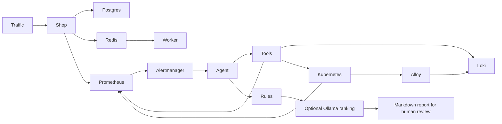

# oncall-triage-agent

A Kubernetes incident triage demo. Alertmanager sends alerts to a FastAPI service that collects read-only evidence, ranks likely causes, and writes a Markdown report with a proposed command and rollback for human review.



## Run the demo

Install Docker, kind, kubectl, Make, and Python 3.12. From the repo root, run:

```bash
make demo
kubectl --context kind-oncall -n oncall rollout status deployment/shop
kubectl --context kind-oncall -n oncall rollout status deployment/prometheus
kubectl --context kind-oncall -n oncall rollout status deployment/triage
./faultctl inject oom
make reports
kubectl --context kind-oncall -n oncall exec deployment/triage -- cat /reports/REPORT_ID.md
./faultctl clear
```

The traffic generator submits orders in the background. Give the telemetry stack time to start before injecting a fault. The eight fault IDs are `bad-deploy`, `slow-query`, `db-leak`, `oom`, `crash-loop`, `redis-down`, `dependency-timeout`, and `cpu-throttle`. The fault CLI targets the `kind-oncall` context and `oncall` namespace.

For the provisioned Grafana dashboard, run `kubectl --context kind-oncall -n oncall port-forward svc/grafana 3000:3000`. Open localhost:3000, sign in with the demo Grafana defaults, and select **On-call demo**. Open Explore and choose Loki to inspect the `{app="shop"}` stream.

## Evaluate

```bash
make replay
make eval EVAL_ARGS='--fault oom'
make eval
```

Replay uses ten authored fixtures, including one case with stale signals and one with missing evidence. The live harness injects eight faults, reads the first matching new report per fault, and measures elapsed time from the injection command to report observation. It waits for telemetry to settle between faults and clears injected configuration when the run exits.

**Measured replay results** from Python 3.12, using `make replay` without Ollama. Confidence is a rule score. The false-confidence rate counts fixtures with a wrong top-ranked cause scoring at least 0.8.

| Mode | Top 1 | Top 3 | Confident and wrong | Live tool calls | Tokens | Model used |
|---|---:|---:|---:|---:|---:|---:|
| Rules | 80% | 90% | 10% | 0 | 0 | 0/10 |
| Model | 0% | 0% | 0% | 0 | 0 | 0/10 |
| Hybrid | 80% | 90% | 10% | 0 | 0 | 0/10 |

The model row measures behavior with the provider unavailable. The hybrid row measures rules fallback. In the overlapping-signal fixture the rules select the wrong cause first, and in the missing-signal fixture they abstain. Runtime output includes mean latency and local inference cost. These results describe the fixture suite. Live fault results and model quality need separate measurements.

To compare all three modes using a local model:

```bash
ollama pull qwen2.5:3b
OLLAMA_URL=http://127.0.0.1:11434 make replay
```

For live model evaluation, set `OLLAMA_URL` on `deployment/triage` to an Ollama endpoint reachable from the cluster, then run `make eval EVAL_ARGS='--mode hybrid'` or `--mode model`. Set `OLLAMA_MODEL` to select a different model.

## Decisions and limits

- The [triage role](ops/rbac.yaml) permits reading pods, events, and ReplicaSets in the demo namespace. Evidence collection uses fixed PromQL, LogQL, and Kubernetes queries. The [MCP server](triage/mcp_server.py) exposes the same five tools over stdio.
- The model receives allowlisted structured signals and candidate IDs. External logs and alert labels stay in the report. Hybrid mode only reorders candidates already supported by the rules, and all proposed commands come from a fixed catalogue. Approval happens outside the agent by reviewing the report before running a command.
- Reports use an ephemeral volume in the agent pod. Export reports before replacing the pod. Credentials and the monitoring configuration are for the local demo.
- Alerts and evidence can overlap while the system recovers. The rules use short windows and a fixed tie order. The demo covers one namespace and one kind node.

## What I would do next

- Capture real evidence from each injected fault and use those snapshots for replay.
- Measure the live cluster and Ollama modes separately, then use the failures to tune signal freshness and tie-breaking.
- Add persistent reports and distributed traces before evaluating the design beyond a local cluster.
