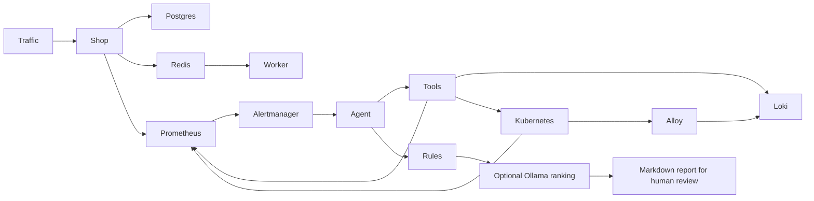

# oncall-triage-agent

A Kubernetes incident triage demo. Alertmanager sends alerts to a FastAPI service that collects read-only evidence, ranks likely causes, and writes a Markdown report with a proposed command and rollback for human review.



[Two-minute walkthrough](docs/oncall-demo.mp4)

## Run the demo

Install Docker, kind, kubectl, Make, and Python 3.12. From the repo root, run:

```bash
make demo
kubectl --context kind-oncall -n oncall rollout status deployment/shop
kubectl --context kind-oncall -n oncall rollout status deployment/prometheus
kubectl --context kind-oncall -n oncall rollout status deployment/triage
./faultctl inject oom
make reports
kubectl --context kind-oncall -n oncall exec deployment/triage -- cat /reports/REPORT_ID.md
./faultctl clear
```

The traffic generator submits orders in the background. Give the telemetry stack time to start before injecting a fault. The eight fault IDs are `bad-deploy`, `slow-query`, `db-leak`, `oom`, `crash-loop`, `redis-down`, `dependency-timeout`, and `cpu-throttle`. The fault CLI targets the `kind-oncall` context and `oncall` namespace.

For the provisioned Grafana dashboard, run `kubectl --context kind-oncall -n oncall port-forward svc/grafana 3000:3000`. Open localhost:3000, sign in with the demo Grafana defaults, and select **On-call demo**. Open Explore and choose Loki to inspect the `{app="shop"}` stream.

## Evaluate

```bash
make replay
make eval EVAL_ARGS='--fault oom'
make eval
```

Replay uses ten authored fixtures, including one case with stale signals and one with missing evidence. The live harness injects eight faults and reads the first matching new report per fault. It measures injection-to-observation and alert-to-report time separately. It waits for telemetry to settle between faults and clears injected configuration when the run exits.

**Measured replay results** from ten fixtures with Ollama and `qwen2.5:0.5b` on a GitHub Actions CPU runner. Confident-and-wrong counts wrong top-ranked causes scoring at least 0.8. These confidence scores are heuristics.

| Mode | Top 1 | Top 3 | Confident and wrong | Mean latency | Total tokens | Model used |
|---|---:|---:|---:|---:|---:|---:|
| Rules | 80% | 90% | 10% | 0.07 ms | 0 | 0/10 |
| Model | 20% | 40% | 0% | 911.07 ms | 1,605 | 10/10 |
| Hybrid | 80% | 90% | 10% | 772.67 ms | 1,691 | 10/10 |

Each replay used zero live evidence calls and $0 in API charges. The model alone missed eight top-ranked causes. Hybrid kept the rules result and added latency on this suite. Rules and hybrid ranked a stale signal first in the overlapping-signal fixture and abstained in the missing-signal fixture. With Ollama unavailable, hybrid also scored 80% top-1 and 90% top-3. [Ollama replay logs](https://github.com/ahmed-145/oncall-triage-agent/actions/runs/45789046156/job/139803111628).

**Live kind results** from one isolated cluster per fault. Rules ranked the expected cause first in all eight cases. Top-3 was 8/8, confident-and-wrong was 0/8, and each investigation used five tools and zero model tokens. [Full evaluation logs](https://github.com/ahmed-145/oncall-triage-agent/actions/runs/45789046156).

| Fault | Injection to observation | Alert to report |
|---|---:|---:|
| `bad-deploy` | 32.1 s | 1.03 s |
| `oom` | 24.8 s | 1.91 s |
| `cpu-throttle` | 27.6 s | 1.69 s |
| `slow-query` | 28.0 s | 2.12 s |
| `crash-loop` | 72.4 s | 2.13 s |
| `dependency-timeout` | 34.3 s | 1.03 s |
| `db-leak` | 19.8 s | 1.69 s |
| `redis-down` | 20.2 s | 1.76 s |
| **Mean** | **32.4 s** | **1.67 s** |

The first live run scored 7/8. CPU throttling produced an alert, but the evidence query's longer window missed the signal. The rerun used the same window for both queries. [Initial live evaluation logs](https://github.com/ahmed-145/oncall-triage-agent/actions/runs/45788443733).

To compare all three modes using a local model:

```bash
ollama pull qwen2.5:0.5b
OLLAMA_URL=http://127.0.0.1:11434 OLLAMA_MODEL=qwen2.5:0.5b make replay
```

For live model evaluation, set `OLLAMA_URL` on `deployment/triage` to an Ollama endpoint reachable from the cluster, then run `make eval EVAL_ARGS='--mode hybrid'` or `--mode model`. Set `OLLAMA_MODEL` to select a different model.

## Decisions and limits

- The [triage role](ops/rbac.yaml) permits reading pods, events, and ReplicaSets in the demo namespace. Evidence collection uses fixed PromQL, LogQL, and Kubernetes queries. The [MCP server](triage/mcp_server.py) exposes the same five tools over stdio.
- The model receives allowlisted structured signals and candidate IDs. External logs and alert labels stay in the report. Hybrid mode only reorders candidates already supported by the rules, and all proposed commands come from a fixed catalogue. Approval happens outside the agent by reviewing the report before running a command.
- Reports use an ephemeral volume in the agent pod. Export reports before replacing the pod. Credentials and the monitoring configuration are for the local demo.
- Alerts and evidence can overlap while the system recovers. The rules use short windows and a fixed tie order. The demo covers one namespace and one kind node.

## What I would do next

- Capture real evidence from each injected fault and use those snapshots for replay.
- Use the replay failures to tune signal freshness and tie-breaking. Re-run the comparison against larger local models.
- Add persistent reports and distributed trace export. The agent logs each investigation stage under its incident ID.

## Publish an incident summary to GitHub

Export a generated report, then preview the issue from your terminal:

```bash
kubectl --context kind-oncall -n oncall exec deployment/triage -- cat /reports/REPORT_ID.md > REPORT_ID.md
python3 -m triage.publish_issue REPORT_ID.md --repo OWNER/REPO
```

Replace `REPORT_ID` with the generated ID. After reviewing the summary, supply
`GITHUB_TOKEN` with Issues write access to the destination and repeat with
`--publish`. The command submits the incident ID and ranked cause titles.
The token stays in the operator's environment. Each publish creates an issue.
